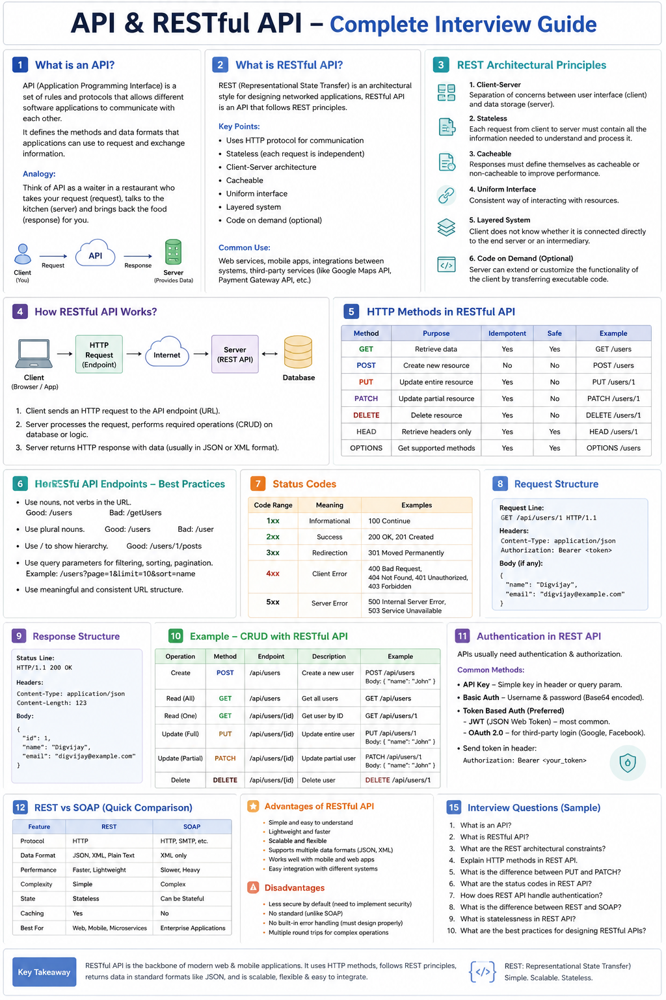

# REST API Interview Questions & Answers

> Basic → Intermediate REST API interview preparation for MERN / Full-Stack interviews.

---

## 1. What is an API?

**Answer:**

API stands for **Application Programming Interface**. It allows two different software systems to communicate with each other.

For example, a React frontend can communicate with a Node.js backend through APIs.

---

## 2. What is REST API?

**Answer:**

REST stands for **Representational State Transfer**. A REST API is an API that follows REST principles and uses HTTP methods to perform operations on resources.

### Example

```text
GET    /users       → Get users
POST   /users       → Create user
PUT    /users/10    → Update user
DELETE /users/10    → Delete user
```

---

## 3. What is a resource in REST?

**Answer:**

A resource is any data or object that the API manages.

### Examples

```text
/users
/products
/orders
/students
```

Each resource is generally identified using a URL.

---

## 4. What are the common HTTP methods?

**Answer:**

| Method | Purpose |
|---|---|
| GET | Retrieve data |
| POST | Create new data |
| PUT | Completely update data |
| PATCH | Partially update data |
| DELETE | Delete data |

### Example

```http
GET /users/5
```

Gets user 5.

```http
DELETE /users/5
```

Deletes user 5.

---

## 5. Difference between PUT and PATCH?

**Answer:**

**PUT** is generally used to replace/update the complete resource.

**PATCH** is used to update only specific fields.

### Example

Suppose the user resource is:

```json
{
  "name": "Rahul",
  "email": "rahul@gmail.com",
  "age": 22
}
```

If we want to change only the age:

```http
PATCH /users/5
```

```json
{
  "age": 23
}
```

---

## 6. What is an endpoint?

**Answer:**

An endpoint is a specific URL through which a client can access a particular API operation.

### Examples

```text
GET /api/users
POST /api/users
GET /api/users/10
```

Each of these is an API endpoint.

---

## 7. What is HTTP?

**Answer:**

HTTP stands for **HyperText Transfer Protocol**. It is the protocol used for communication between clients and servers on the web.

REST APIs commonly use HTTP methods such as:

- GET
- POST
- PUT
- PATCH
- DELETE

---

## 8. What is the difference between REST and RESTful API?

**Answer:**

**REST** is an architectural style containing principles and constraints.

A **RESTful API** is an API that follows those REST principles.

---

## 9. What are HTTP status codes?

**Answer:**

HTTP status codes tell the client what happened with the request.

### Common Status Codes

```text
200 → OK
201 → Created
204 → No Content

400 → Bad Request
401 → Unauthorized
403 → Forbidden
404 → Not Found
409 → Conflict

500 → Internal Server Error
```

---

## 10. Difference between 401 and 403?

**Answer:**

### 401 Unauthorized

The client has not provided valid authentication credentials.

### 403 Forbidden

The client is authenticated but does not have permission to access the resource.

### Simple Example

```text
401 → You are not logged in.
403 → You are logged in, but you don't have permission.
```

---

## 11. Difference between 200 and 201?

**Answer:**

### 200 OK

The request was successfully processed.

### 201 Created

A new resource was successfully created.

For example, after:

```http
POST /users
```

The server can return:

```text
201 Created
```

---

## 12. What is a request?

**Answer:**

A request is the message sent by the client to the server.

It can contain:

- URL
- HTTP method
- Headers
- Query parameters
- Body

### Example

```http
POST /api/users
Content-Type: application/json
```

Request body:

```json
{
  "name": "Rahul",
  "email": "rahul@gmail.com"
}
```

---

## 13. What is a response?

**Answer:**

A response is the message sent by the server back to the client.

It usually contains:

- Status code
- Headers
- Response body

### Example

```json
{
  "success": true,
  "user": {
    "id": 10,
    "name": "Rahul"
  }
}
```

---

## 14. What are HTTP headers?

**Answer:**

Headers contain additional information about the request or response.

### Example

```http
Content-Type: application/json
Authorization: Bearer <token>
```

`Content-Type` tells the server what type of data is being sent.

`Authorization` can contain authentication credentials such as a JWT.

---

## 15. What is the request body?

**Answer:**

The request body contains data sent from the client to the server.

### Example

```http
POST /api/users
```

Body:

```json
{
  "name": "John",
  "email": "john@gmail.com",
  "password": "123456"
}
```

It is commonly used with:

- POST
- PUT
- PATCH

---

## 16. What are query parameters?

**Answer:**

Query parameters are parameters added after `?` in a URL.

### Example

```text
GET /products?category=mobile&sort=price
```

Here:

```text
category = mobile
sort = price
```

Query parameters are commonly used for:

- Filtering
- Sorting
- Searching
- Pagination

---

## 17. What are path parameters?

**Answer:**

Path parameters are values included directly in the URL path.

### Example

```text
GET /users/25
```

Here `25` is the user ID.

### Express Example

```javascript
app.get("/users/:id", (req, res) => {
    console.log(req.params.id);
});
```

---

## 18. Query parameter vs path parameter?

**Answer:**

### Path Parameter

Usually identifies a specific resource:

```text
/users/25
```

### Query Parameter

Usually modifies or filters a request:

```text
/users?role=admin
```

### Easy Way to Remember

```text
/users/25           → Which user?

/users?role=admin   → Which users matching a condition?
```

---

## 19. What does stateless mean in REST?

**Answer:**

Stateless means the server does not store the client's session state between requests.

Each request should contain all the information needed by the server to process it.

For example, with JWT authentication:

```http
Authorization: Bearer <JWT>
```

The client sends the token with each protected request.

---

## 20. What is JSON and why is it commonly used in REST APIs?

**Answer:**

JSON stands for **JavaScript Object Notation**. It is a lightweight format for exchanging data between client and server.

### Example

```json
{
  "name": "Rahul",
  "age": 22
}
```

It is popular because it is easy for both humans and programming languages to read and process.

---

# Authentication & Security Questions

## 21. How do you authenticate a REST API?

**Answer:**

Common approaches include:

- JWT
- Session-based authentication
- OAuth 2.0
- API keys

In a MERN application, **JWT-based authentication** is commonly used.

---

## 22. What is JWT?

**Answer:**

JWT stands for **JSON Web Token**. It is a token commonly used to securely transmit authentication information between client and server.

### Typical Flow

```text
Login
  ↓
Server verifies credentials
  ↓
Server generates JWT
  ↓
Client stores token
  ↓
Client sends JWT with protected requests
  ↓
Server verifies JWT
```

---

## 23. Where is JWT sent in a request?

**Answer:**

Usually in the `Authorization` header:

```http
Authorization: Bearer <JWT>
```

---

## 24. What is CORS?

**Answer:**

CORS stands for **Cross-Origin Resource Sharing**.

It controls whether a browser allows a web application from one origin to access resources from another origin.

### Example

```text
Frontend: http://localhost:5173
Backend:  http://localhost:5000
```

These are different origins, so CORS configuration may be required.

---

## 25. How do you secure a REST API?

**Answer:**

Some common practices are:

- Use HTTPS
- Implement authentication and authorization
- Validate input
- Hash passwords using bcrypt/Argon2
- Use appropriate CORS configuration
- Rate-limit sensitive endpoints
- Never expose secrets in source code
- Use environment variables for secrets
- Return appropriate error messages without leaking sensitive information

---

# Practical Interview Questions

## 26. Explain the flow of a REST API request.

**Answer:**

For a MERN application:

```text
React Frontend
      ↓
HTTP Request
      ↓
Express Route
      ↓
Middleware
      ↓
Controller
      ↓
MongoDB
      ↓
Controller
      ↓
HTTP Response
      ↓
React Frontend
```

### Example

```text
GET /api/products
```

The request reaches the Express route, the controller retrieves products from MongoDB, and the server returns JSON to React.

---

## 27. What is middleware in REST API?

**Answer:**

Middleware is a function that runs between the incoming request and the final route handler.

It can be used for:

- Authentication
- Authorization
- Logging
- Validation
- Error handling

### Express Example

```javascript
app.use(express.json());
```

This middleware allows Express to parse JSON request bodies.

---

## 28. What is API versioning?

**Answer:**

API versioning allows you to maintain different versions of an API without breaking existing clients.

### Example

```text
/api/v1/users
/api/v2/users
```

If you make major changes to the API, you can introduce `v2` while keeping `v1` available.

---

## 29. What is pagination in REST API?

**Answer:**

Pagination means returning data in smaller portions instead of sending all records at once.

### Example

```text
GET /products?page=2&limit=10
```

This requests 10 products from page 2.

Pagination improves performance when there are many records.

---

## 30. What is idempotency?

**Answer:**

An operation is idempotent if making the same request multiple times has the same intended result as making it once.

For example:

```text
PUT /users/10
```

with the same data can be sent multiple times without continually creating new users.

`GET`, `PUT`, and `DELETE` are generally considered idempotent, while `POST` is generally not.

---

# ⭐ Most Important Questions for Freshers

For a **MERN / Full-Stack interview**, prioritize these questions:

1. What is an API?
2. What is REST API?
3. What are HTTP methods?
4. GET vs POST
5. PUT vs PATCH
6. What are status codes?
7. 401 vs 403
8. 200 vs 201
9. What are headers?
10. What is request body?
11. Query vs path parameters
12. What does stateless mean?
13. What is JSON?
14. What is JWT?
15. How does JWT authentication work?
16. What is middleware?
17. What is CORS?
18. How do you secure an API?
19. Explain REST API flow in your MERN project
20. What is pagination?

---

# 🔥 Important Project-Based Interview Question

## "You mentioned REST API in your resume. Explain how you used it in your project."

### Interview-Ready Answer

> In my MERN project, I created RESTful APIs using Node.js and Express. I used GET APIs for retrieving data, POST for creating resources, PUT/PATCH for updating them, and DELETE for removing them. I also used middleware for authentication and validation, JWT for protected routes, MongoDB for data storage, and returned appropriate HTTP status codes and JSON responses.

### Why This Answer Is Strong

It connects multiple concepts:

```text
REST API
   ↓
Express
   ↓
HTTP Methods
   ↓
Middleware
   ↓
JWT Authentication
   ↓
MongoDB
   ↓
HTTP Status Codes
   ↓
JSON Response
```

---

# Quick REST API Revision

```text
REST
 ↓
Architectural Style

HTTP Methods
 ↓
GET    → Read
POST   → Create
PUT    → Replace/Update
PATCH  → Partial Update
DELETE → Delete

Request
 ↓
URL + Method + Headers + Params + Body

Response
 ↓
Status Code + Headers + Body

Authentication
 ↓
JWT / Sessions / OAuth / API Keys

Common Status Codes
 ↓
200 → Success
201 → Created
400 → Bad Request
401 → Authentication required/failed
403 → Forbidden
404 → Not Found
500 → Server Error
```

---

# MERN REST API Stack

```text
React
  ↓
Axios / Fetch
  ↓
REST API
  ↓
Node.js
  ↓
Express.js
  ↓
Middleware
  ↓
Controller
  ↓
MongoDB
```

This is the basic architecture you should be able to explain confidently in a MERN interview.


